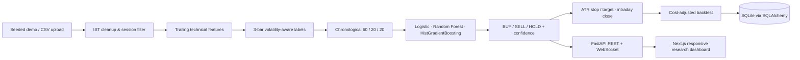

# SignalForge

**AI Intraday Buy/Sell Signal Generator** · Astraquant X-2026 · KLH Aziz Nagar

SignalForge is an offline-first research workbench for 5-minute NSE equity data. It demonstrates chronological ML evaluation, probability-based BUY / SELL / HOLD signals, ATR risk levels, live simulated updates and a transaction-cost-aware backtest. The bundled bars are deterministic **synthetic demo data**, not historical exchange prices. No broker connection or order execution is included.

> **Risk disclaimer:** Educational and research use only; not financial advice or a recommendation to buy or sell any security. Simulated or historical performance does not predict future results.

## Architecture



The source is divided between `backend/app/{api,backtest,core,data,features,models}` and `frontend/{app,components,lib}`. Data features use trailing windows; forward labels that cross a session boundary are excluded. Model selection uses validation macro-F1, never the final chronological test block.

## Quick start (Docker)

Requirements: Docker Desktop with Compose.

```powershell
docker compose up --build
```

Open:

- Web app: <http://localhost:3000>
- API health: <http://localhost:8000/api/health>
- Interactive API docs: <http://localhost:8000/docs>

The first build creates a persistent `backend-data` volume for SQLite. The seeded OHLCV CSV is copied into the API image, so the app does not need a market-data API or network access at runtime.

## Local development

Requirements: Python 3.11 and Node.js 20+.

### Backend

From the repository root, in PowerShell:

```powershell
py -3.11 -m venv .venv
.\.venv\Scripts\Activate.ps1
python -m pip install -r backend\requirements.txt
python backend\scripts\seed_demo.py
python -m uvicorn app.main:app --app-dir backend --reload --port 8000
```

### Frontend

In another terminal:

```powershell
Set-Location frontend
Copy-Item .env.example .env.local
npm ci
npm run dev
```

The frontend reads `NEXT_PUBLIC_API_URL` at build time (default `http://localhost:8000`). Configure `CORS_ORIGINS`, `DATA_PATH` and `DATABASE_PATH` in the root `.env` as needed. The header confirms both the API and database connection. For a local `uvicorn` process started from the project root, defaults are `backend/data/demo_ohlcv.csv` and `backend/data/signalforge.db`.

## Features

- **Dashboard:** NSE symbol selector, interactive TradingView lightweight-charts candlesticks, current simulated signal, confidence, entry reference, ATR stop/target and IST clock.
- **Live signals:** simulated WebSocket feed (`/ws/signals`), filters, visual updates and optional browser tone; polling fallback if WebSocket is unavailable.
- **Backtesting:** configurable threshold, ATR multipliers, capital and costs; equity path, drawdown, trade log, KPI cards and CSV export.
- **Model performance:** chronological train/validation/test comparison, confusion matrix, one-vs-rest ROC, calibration and feature-importance views. Train jobs report progress over WebSocket.
- **Data explorer:** trailing-indicator preview and CSV upload; required columns are `datetime, open, high, low, close, volume`. An optional `symbol` column is accepted when seeding data.
- **Methodology and About:** KaTeX equations, pipeline, evaluation criteria and explicit limitations/risk disclaimer.
- **Responsive UI:** mobile-first navigation, 320px+ layouts, dark/light theme, loading/error states and accessible labels.

### API overview

| Route | Purpose |
|---|---|
| `GET /api/health` | API and database health check |
| `POST /api/data/fetch` | Select offline data or upload CSV multipart (`symbol`, `file`) |
| `GET /api/data/{symbol}` | Clean OHLCV and trailing indicators |
| `POST /api/model/train` | Queue model training; returns `job_id` |
| `GET /api/model/train/{job_id}` | Poll training status |
| `GET /api/model/metrics?symbol=RELIANCE` | Holdout metrics, confusion matrix and comparison |
| `GET /api/model/explain?symbol=RELIANCE` | Feature importance |
| `GET /api/signals/latest` | Latest persisted signal for one/all demo symbols |
| `GET /api/signals/history` | Persisted signal history with optional symbol filter |
| `WS /ws/signals` | Simulated signal stream |
| `WS /ws/training/{job_id}` | Training progress |
| `POST /api/backtest/run` | Run a simulation and persist results |
| `GET /api/backtest` | List recent persisted runs |
| `GET /api/backtest/{id}` | Retrieve a stored backtest and trade log |

## Data and model notes

- Demo data is reproducible and synthetic, generated by `backend/app/data/market_data.py`; regenerate with `python backend\scripts\seed_demo.py`.
- CSV timestamps are normalized to IST; malformed prices, duplicates and out-of-session rows are removed. Uploading replaces the selected symbol in memory for the current API process.
- Feature set includes returns (1/3/5/10 bars), RSI, MACD, Bollinger position/width, EMA spreads, session VWAP deviation, ATR, stochastic, ADX, OBV change, volume z-score, candle ratios, rolling volatility, time encoding and opening-range breakout.
- Labels use next-three-bar log return against trailing 20-bar volatility. Rows without sufficient history, a full forward horizon or a same-session horizon are omitted.
- Baselines are Logistic Regression, Random Forest and HistGradientBoosting. Training is chronological; the validation segment selects a model. Metrics and probability plots are informational and can be unstable on synthetic data.
- The standalone backtest uses a **lagged-momentum demo rule**, one-percent risk-based position sizing, a configurable daily loss lock, bar-based fills, configurable basis-point costs, ATR exits, a three-bar holding cap and a 15:15 IST square-off. It is not the selected ML classifier's historical strategy simulation. Slippage, market impact, precise Indian taxes, corporate actions and broker execution are not modeled.
- SQLite persistence (runs, trade records, signal snapshots, and latest trained-model results) is implemented with SQLAlchemy. The UI reads persisted signal history and recent backtests from the API; model results are reused after an API restart. Parquet, external broker feeds, LightGBM/XGBoost, sequence models, Optuna and SHAP are not required for the offline demo and are not represented as active capabilities.

## Tests and notebook

```powershell
$env:PYTHONPATH = "backend"
.\.venv\Scripts\python -m pytest backend\tests -q
Set-Location frontend
npm run lint
npm run build
```

`train_and_evaluate.ipynb` reproduces data loading, feature/label creation, chronological splits, model metrics and the demo backtest. Run it from the repository root after installing `backend\requirements.txt` and Jupyter:

```powershell
python -m pip install jupyter matplotlib
jupyter lab train_and_evaluate.ipynb
```

## Screenshots

Capture screenshots from the running app and place them in `frontend/public/screenshots/` before submission:

| View | Screenshot |
|---|---|
| Overview | `overview.png` |
| Dashboard | `dashboard.png` |
| Backtesting | `backtesting.png` |
| Model performance | `performance.png` |

## Round 2 deliverables map

| Deliverable | Repository location |
|---|---|
| Working application and system architecture | `frontend/app/`, `frontend/components/`, `backend/app/`, `docker-compose.yml`, architecture above |
| Data preparation, feature engineering and model pipeline | `backend/app/data/`, `backend/app/features/`, `backend/app/models/`, `train_and_evaluate.ipynb` |
| Backtesting, risk controls and quantitative evaluation | `backend/app/backtest/`, `backend/tests/`, `frontend/app/backtesting/`, `frontend/app/performance/` |
| Reproducible demo, setup and presentation documentation | `backend/scripts/seed_demo.py`, `backend/data/demo_ohlcv.csv`, `README.md`, `frontend/public/screenshots/` |

## Deployment

- **Vercel hosts the frontend; it does not host this complete stack.** The FastAPI backend uses WebSockets and SQLite persistence, so deploy it separately on Render or another service that supports both. Do not set `NEXT_PUBLIC_API_URL` to `localhost` in production.
- Push the repository to a Git provider such as GitHub.
- Deploy the backend using the root `render.yaml` Blueprint (or deploy `backend/Dockerfile`). Set `CORS_ORIGINS` to the exact production Vercel origin, for example `https://signalforge.vercel.app` (no trailing slash). Set `DATA_PATH=/app/seed/demo_ohlcv.csv`. For SQLite, set `DATABASE_PATH=/app/data/signalforge.db` and attach persistent storage at `/app/data`; without a persistent disk or external database, saved runs and signals may be lost when the service restarts.
- In Vercel, import the repository and set **Root Directory** to `frontend`. Use the detected Next.js framework, `npm ci` for install and `npm run build` for build. Add `NEXT_PUBLIC_API_URL` to the Production environment with the backend origin only, e.g. `https://signalforge-api.onrender.com` (no `/api` suffix), then deploy. This public variable is embedded at build time; redeploy after changing it.
- If the Vercel production URL is not known when configuring the backend, deploy the frontend first, then update the backend's `CORS_ORIGINS` with the exact Vercel production origin and redeploy/restart the API. Preview deployments have different origins and need their own CORS configuration if they must access the API.
- Verify `https://<backend-host>/api/health` reports `database: connected`, then open the Vercel deployment and confirm dashboard data loads and the live signal feed connects. The API must allow the frontend origin and support WebSockets.
- The frontend and backend deployment steps require accounts with their respective hosts; never put host credentials or tokens in this repository.

This repository is a hackathon prototype; review model, market-data licensing, exchange rules, deployment security and operational risk before any non-educational use.
